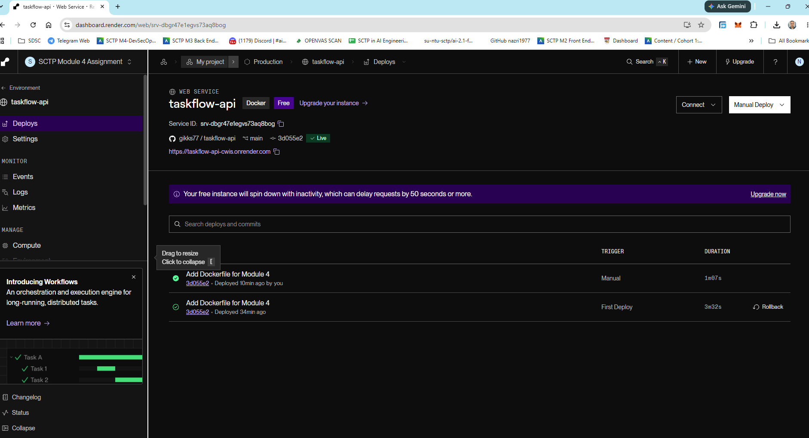
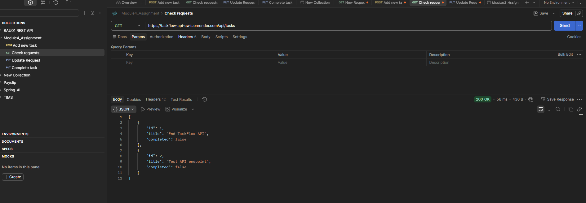

# TaskFlow API

TaskFlow is a Java Spring Boot application packaged with Docker and deployed on Render.

## Deployment Platform

I am using **Render instead of Railway** to deploy this application because Railway was unavailable when I needed to deploy it.

The application is deployed from my GitHub repository using the project's Dockerfile.

## Live Application URL

[View the live TaskFlow API](https://taskflow-api-cwis.onrender.com/api/tasks)

```text
https://taskflow-api-cwis.onrender.com/api/tasks
```


## Deployment Screenshots

### 1. Render Dashboard — Active Deployment



### 2. Live Application Working



## Technology Stack

- Java
- Spring Boot
- Docker
- Render

## Deployment Process

1. Push the application source code and Dockerfile to GitHub.
2. In Render, create a new Web Service and connect the TaskFlow repository.
3. Select Docker as the runtime.
4. Configure the environment variables:

   | Variable | Value |
   | --- | --- |
   | `PORT` | `8080` |
   | `SERVER_PORT` | `8080` |
   | `SERVER_ADDRESS` | `0.0.0.0` |

5. Deploy the service and check the deployment logs.
6. Open the public Render URL and test `/api/tasks`.

## Screenshot Files

```text
README.md
screenshots/
├── render-dashboard.png
└── live-application.png
```
